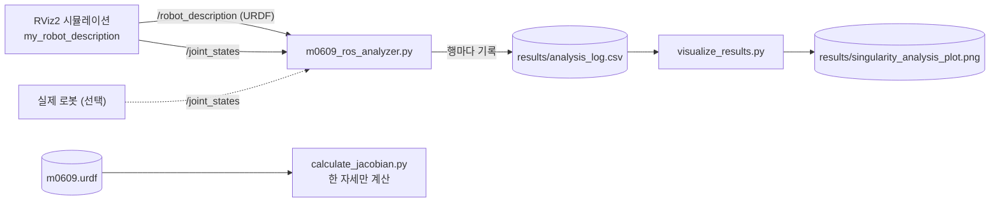
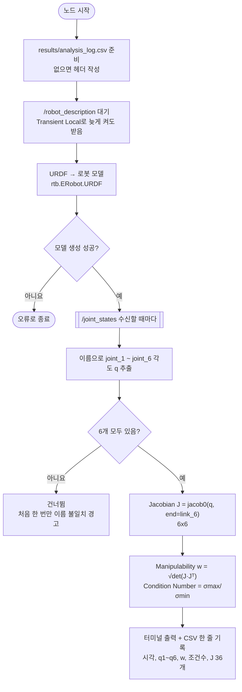

# 🐊 singularity_analysis
동아대학교 기계공학과 2026-1학기 동역학1분반 취업공결 인정 과제

ROS2 Humble 기반의 6축 산업용 로봇(M0609) 의 Jacobian 행렬을 실시간으로 계산하고,
Manipulability / Condition Number 기반으로 Singularity(특이점) 를 분석하는 프로젝트입니다.

본 프로젝트는 다음 기능을 제공합니다.

- 실시간 /joint_states 구독
- Jacobian Matrix 계산
- Manipulability 분석
- Condition Number 분석
- 특이점 감지
- CSV 로그 저장
- 분석 결과 시각화

2026.04.24 현재, m0609 6축 로봇팔만 지원하며, m0609의 시뮬레이션(Rviz2)은 https://github.com/yoonheon051/my_robot_description 여기서 확인할 수 있습니다.

## 개발환경
OS: UBUNTU 22.04.05 LTS

Framework: ROS2 Humble

Language: Python 3.10.12

Key Library: NumPy 1.24.4, Roboticstoolbox-python, PyKDL, pandas·matplotlib(시각화)

설치: `pip install -r requirements.txt`

## 파일 구성
```
singularity_analysis
├── .gitignore              # git 제외 목록
├── README.md               # 프로젝트 메뉴얼
├── requirements.txt        # 의존성 라이브러리 목록
├── scripts/                # 실행할 메인 스크립트
│   ├── calculate_jacobian.py
│   ├── m0609_ros_analyzer.py 
│   └── visualize_results.py
└── results/                # 분석 결과 이미지나 로그 저장
```

## 프로젝트 의도

### 1. 실시간 Jacobian 데이터 연산 및 획득
 - Kinematic Tree 구축: 로봇의 URDF 파일로부터 KDL(Kinematics and Dynamics Library) 트리를 생성하여 수학적 연산 기반 마련.
 - 데이터 획득 기법:
    - Roboticstoolbox(rtb): get_jacobian_matrix()를 호출하여 현재 포즈에 대한 $6 \times 6$ Geometric Jacobian 획득.
    - Numerical Analysis: 실시간 관절 각도($q$)를 입력으로 하여 Jacobian 행렬($J(q)$)을 즉시 산출.

### 2. 가동성 타원체(Manipulability Ellipsoid)를 통한 특이점(Singularity) 가시화
로봇 말단(End-effector)의 운동 성능을 기하학적으로 해석합니다.
- 특이점 판별: 
    - Normal State: 타원체가 구(Sphere)에 가까운 형태를 유지하며 모든 방향으로 균등한 이동성 확보.
    - Near Singularity: 타원체가 특정 축으로 편평(Flattened)해지며, 해당 방향으로의 속도 생성이 불가능한 물리적 한계점 분석.

### 3. 매칭 테이블
```
--------------------------------------------------------------------------------
항목            | 실제 구현 파일           | 구현 방식
--------------------------------------------------------------------------------
Kinematic Tree | m0609_ros_analyzer.py | rtb.ERobot.URDF를 통한 모델 로드
--------------------------------------------------------------------------------
실시간 데이터 획득 | m0609_ros_analyzer.py | /joint_states 토픽 구독 및 실시간 연산
--------------------------------------------------------------------------------
Jacobian 산출   | calculate_jacobian.py | jacob0(q) 함수로 $6 \times 6$ 행렬 생성
--------------------------------------------------------------------------------
특이점 분석 지표  |          공통          | manipulability(), np.linalg.cond() 활용
--------------------------------------------------------------------------------
결과 저장        | m0609_ros_analyzer.py | results/analysis_log.csv 파일로 기록
--------------------------------------------------------------------------------
```

## 프로젝트 개요

산업용 로봇은 특정 자세에서 자유도를 일부 잃게 되는 Singularity(특이점) 문제가 발생합니다.

특이점 근처에서는:

1. 특정 방향으로 이동 불가능
2. 제어 오차 급증
3. 속도 명령 폭주
4. 진동 및 불안정성 증가

와 같은 문제가 발생합니다.

본 프로젝트는 Jacobian 기반의 기구학 분석을 통해 이러한 특이점을 실시간으로 탐지하고 시각화합니다.

## 사용 이론

### Jacobian Matrix

로봇의 관절 속도와 말단 속도의 관계:

$\dot{x}$ =J(q) $\dot{q}$

- $\dot{q}$ : Joint Velocity

- $\dot{x}$ : End-effector Velocity

- J(q): Jacobian Matrix

## Manipulability

Yoshikawa Manipulability Index:

w = $\sqrt{\det(JJ^T)}$

- 값이 클수록 좋은 자세
- 0에 가까울수록 특이점 접근

Condition Number

Jacobian의 수치적 안정성:

$\kappa(J) = \frac{\sigma_{max}}{\sigma_{min}}$

- 1에 가까울수록 이상적
- 값이 커질수록 특이점 근접

## 파일 별 상세 설명

### calculate_jacobian.py
Jacobian 계산 및 기구학 분석을 수행하는 핵심 분석 파일입니다.

주요기능

1. Forward Kinematics 계산

```
T = robot.fkine(q)
```
입력된 관절 각도로부터 End-effector Pose 계산

2. Jacobian Matrix 계산

```
J = robot.jacob0(q)
```
Base Frame 기준의 Geometric Jacobian 계산

3. Manipulability 계산

```
w = robot.manipulability(q)
```
현재 자세의 가동성 평가

4. Condition Number 계산

```
cond = np.linalg.cond(J)
```
특이점 근접 여부 분석

5. Wrist Singularity 테스트

```
--q 0 0 1.5708 0 0.01 0   (기본값)
```
5번 관절(q5)을 0 근처로 설정하여 Wrist Singularity를 인위적으로 생성. 다른 자세는 `--q`로 6개 각도(rad)를 넘깁니다.

6. 실행 방법

M0609 URDF 파일 경로를 인자로 줍니다(생략하면 현재 폴더의 `m0609.urdf`).
[my_robot_description](https://github.com/yoonheon051/my_robot_description)의 `urdf/m0609.urdf.xacro`는 xacro 매크로가 없는 일반 URDF라 그대로 써도 되고, `xacro`로 변환해도 됩니다.

```
cd ~/singularity_analysis

ros2 run xacro xacro ~/colcon_ws/src/my_robot_description/urdf/m0609.urdf.xacro > m0609.urdf
python3 scripts/calculate_jacobian.py m0609.urdf
python3 scripts/calculate_jacobian.py m0609.urdf --q 0 -0.3 1.2 0 1.0 0   # 다른 자세
```

7. 실행 예시 (기본 자세, my_robot_description의 m0609 URDF 기준)

```
Joint angles (rad): [0.0, 0.0, 1.571, 0.0, 0.01, 0.0]
Jacobian Matrix:
[[ ... ]]
Determinant: -0.000557
Manipulability Index: 0.000557
Condition Number: 797.47
```
같은 URDF에서 특이점이 아닌 자세(`--q 0 -0.3 1.2 0 1.0 0`)는 Manipulability 0.0198, Condition Number 20.1 정도로, 손목 특이점 근처보다 조건수가 약 40배 작습니다.

### m0609_ros_analyzer.py
ROS2 기반 실시간 특이점 분석 노드입니다.

프로젝트의 핵심 실행 파일입니다.

주요 역할

1. /robot_description 구독

```
self.create_subscription(
    String,
    '/robot_description',
    ...
)
```

2. URDF 기반 Robot Model 생성

```
self.robot = rtb.ERobot.URDF(tmp_path)
```
URDF → Kinematic Model 변환

3. /joint_states 실시간 구독

```
self.create_subscription(
    JointState,
    '/joint_states',
    ...
)
```
현재 관절 각도 수신

4. Jacobian 실시간 계산

```
J_full = self.robot.jacob0(q)
```
실시간 Jacobian 계산

5. Manipulability 실시간 분석

```
w = self.robot.manipulability(q)
```

6. Condition Number 계산

```
cond = np.linalg.cond(J)
```
특이점 근접 여부 분석

7. CSV 자동 저장

```
results/analysis_log.csv
```

다음 데이터를 저장:

- Timestamp
- q1 ~ q6
- Manipulability
- Condition Number
- 6x6 Jacobian Matrix

8. 저장되는 CSV 예시

```
----------------------------------------------------------------------------------
timestamp | q1  | q2  | q3  | q4  | q5  | q6  | manipulability | condition_number 
----------------------------------------------------------------------------------
12:34:56  | 0.1 | 0.2 | ... | ... | ... | ... |     0.034      | 52.1
----------------------------------------------------------------------------------
```

### visualize_results.py
수집된 분석 데이터를 그래프로 시각화합니다.

주요 기능

1. Manipulability 그래프

```
ax1.plot(df['manipulability'])
```
- 값 감소 → 특이점 접근
- V자 형태 → 위험 구간

2. Condition Number 그래프

```
ax2.plot(df['condition_number'])
```
- 값 급증 → 제어 불안정
- 로그 스케일 사용

3. 특이점 임계값 표시

```
ax1.axhline(y=0.01)
```

4. 실행 방법

```
python3 scripts/visualize_results.py
```

5. 출력 결과

- Manipulability 그래프
- Condition Number 그래프
- 특이점 위험 구간 시각화

## 전체 실행 순서

### 1. ROS2 환경 Source

```
source /opt/ros/humble/setup.bash
```

### 2. 워크스페이스 Build

```
cd ~/colcon_ws

colcon build

source install/setup.bash
```

### 3. 로봇 시뮬레이터 실행

M0609 URDF 및 /joint_states 발행 필요

예시 : 

```
ros2 launch my_robot_description rviz_sim.launch.py
```

m0609 RViz2 시뮬레이션: https://github.com/yoonheon051/my_robot_description

### 4. 특이점 분석 노드 실행

새 터미널: 

```
cd ~/singularity_analysis

python3 scripts/m0609_ros_analyzer.py
```

### 5. 로봇 움직이기

Rviz2 또는 실제 로봇에서 Joint 값 변화

### 6. CSV 결과 확인

```
results/analysis_log.csv
```

### 7. 결과 시각화

```
python3 scripts/visualize_results.py
```
그래프는 화면에 띄우고 `results/singularity_analysis_plot.png`로도 저장합니다. 다른 CSV를 보려면 경로를 인자로 줍니다(`python3 scripts/visualize_results.py 다른.csv`).

## 분석 흐름

### 전체 구성



### 실시간 분석 노드 (`m0609_ros_analyzer.py`)



### 특이점 판단


0.01은 `visualize_results.py`가 그래프에 그리는 경고선 값입니다. 예를 들어 my_robot_description의 M0609에서 q5를 0.8 → -0.8 rad로 움직이면, w는 q5 = 0에서 0으로 떨어지고(V자) 조건수는 10¹⁷ 정도까지 치솟습니다.

### 말단 링크를 `link_6`으로 지정하는 이유
M0609 URDF에는 끝이 열린 링크가 두 개 있습니다. 높이 표시용 `base`(base_link 위 0.45 m)와 말단 `tool0`입니다. Robotics Toolbox는 말단을 지정하지 않으면 그중 **첫 번째**를 말단으로 고르는데, URDF에서 `base`가 먼저 나와서 엉뚱한 Jacobian이 계산될 수 있습니다(터미널에 "More than one end-effector present" 경고가 뜹니다). 그래서 두 스크립트 모두 `link_6`을 명시합니다. `link_6`은 `tool0`과 원점이 같아 `jacob0` 결과가 같습니다.

## 특이점 판단 기준

```
-----------------------------------------------------
상태              | Manipulability | Condition Number
-----------------------------------------------------
Normal           |       큼        | 낮음
-----------------------------------------------------
Near Singularity |    매우 작음     | 매우 큼
-----------------------------------------------------
Singularity      |     0 근접      | infinity
-----------------------------------------------------
```
