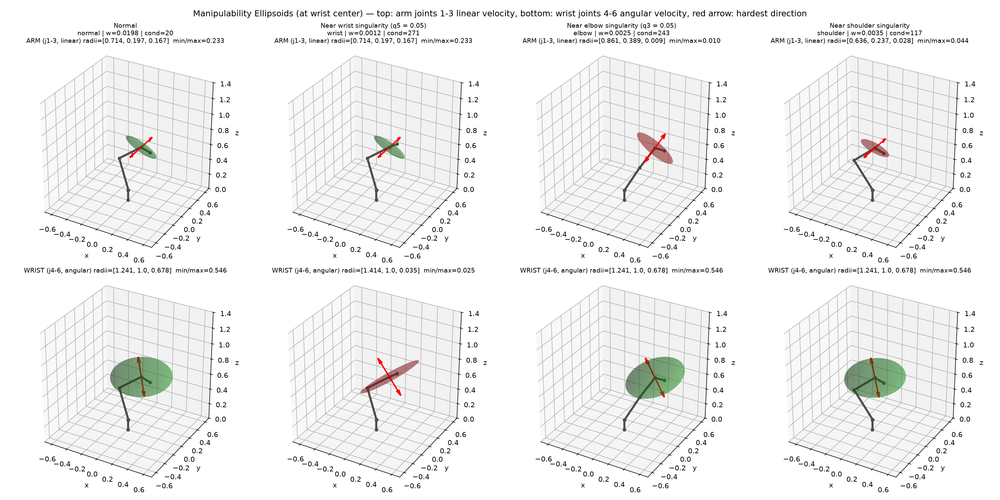

# 🐊 singularity_analysis
[](https://github.com/yoonheon051/singularity_analysis/actions/workflows/test.yml)

동아대학교 기계공학과 2026-1학기 동역학1분반 취업공결 인정 과제

두산 M0609 6축 로봇팔의 Jacobian 을 실시간으로 계산해, **특이점(Singularity)에 얼마나 가까운지**를 분석하고 보여 주는 ROS2(Jazzy·Humble) 패키지입니다.
시뮬레이션(관절 슬라이더)과 실제 로봇 모두에서 동작합니다.

- **실시간 분석**: `/joint_states` → Jacobian, Manipulability, 조건수, 특이점 종류(손목·팔꿈치·어깨)
- **웹 대시보드**: 관절 J1~J6 별 위험도(초록 → 노랑 → 빨강), 임계 도달 예상 시간, 벗어나는 방향
- **RViz 가동성 타원체**와 **CSV 기록·그래프**
- **실제 M0609 연동**: 두산 드라이버의 관절값을 읽기만 해서 분석 (로봇에 명령을 보내지 않음)
- **이론 실험**: 특이점 종류 분류(det J 분해), 속도 명령 폭주 vs 감쇠 최소제곱(DLS)

| 문서 | 내용 |
|---|---|
| [docs/theory.md](docs/theory.md) | 이론과 실험: Jacobian·가동성 타원체, 특이점 종류 분류 유도, 근접도 계산, DLS 실험 |
| [docs/usage.md](docs/usage.md) | 사용법 상세: launch 옵션, 토픽·파라미터, CSV, 개별 스크립트 |
| [docs/development.md](docs/development.md) | 개발자 문서: 직접 설치, 분석 흐름, 상태 JSON 형식, 테스트·CI |

## 빠른 시작

| OS | ROS2 | Python |
|---|---|---|
| **Ubuntu 24.04** | **Jazzy** | 3.12 |
| Ubuntu 22.04 | Humble | 3.10 |

ROS2 가 설치되어 있으면:

```bash
# 처음 한 번: 받기 → 설치·빌드 (sudo 비밀번호를 물을 수 있음)
mkdir -p ~/colcon_ws/src && cd ~/colcon_ws/src
git clone https://github.com/yoonheon051/singularity_analysis.git
./singularity_analysis/setup.sh

# 실행 (새 터미널마다 env.sh 먼저)
source ~/colcon_ws/env.sh
ros2 launch singularity_analysis analysis.launch.py
```

- `setup.sh` 는 ROS 버전 찾기, 의존성(rosdep), Robotics Toolbox 설치(워크스페이스 가상환경 `~/colcon_ws/.venv`), 빌드를 하고, 실행 환경을 켜는 `~/colcon_ws/env.sh` 를 만듭니다. `git pull` 한 뒤나 Ubuntu·ROS 버전을 바꾼 뒤에도 다시 실행하면 됩니다.
- 매번 `source` 하기 귀찮으면 `echo 'source ~/colcon_ws/env.sh' >> ~/.bashrc`.

실행하면 관절 슬라이더 창과 RViz 가 뜹니다.
- 슬라이더로 로봇을 움직이면 RViz 의 가동성 타원체가 특이점 근처에서 납작해지고 빨갛게 바뀌며, 터미널에 경고가 뜹니다.
- 브라우저로 **http://localhost:8080** 을 열면 대시보드가 보입니다.
- 결과 CSV 는 `~/singularity_results/` 에 쌓이고, `ros2 run singularity_analysis visualize_results` 로 그래프를 그립니다.

launch 옵션과 다른 스크립트는 [사용법 상세](docs/usage.md)를 보세요.

## 실시간 대시보드


launch 가 셋 다 띄우므로 **http://localhost:8080** 만 열면 됩니다. 같은 네트워크의 태블릿·폰에서는 `http://<PC IP>:8080`.

- **로봇팔 (맨 위)**: 현재 관절각으로 그린 M0609. 관절 색이 위험도에 따라 **초록(안전) → 노랑 → 빨강(특이점 근처)**. 벗어나려면 돌릴 관절은 점선 원과 `+`/`−` 로 표시. 드래그로 돌려 보고 더블클릭하면 처음 시점
- **전체 위험도**: 안전 / 주의 / 위험 + 0~100%, 가장 위험한 관절과 이유(예: "J4·J6 회전축이 거의 일직선"), "이 속도면 N초 후 임계 도달", 벗어나는 방향
- **관절 카드 J1~J6**: 각도, 위험도, 도달 예상 시간
- **최근 30초 관절 위험도 그래프**와 **위험 조건** 세 가지의 물리량·임계값

관절 위험도는 그 관절이 걸린 특이점 조건에 얼마나 가까운지(근접도)입니다.

| 화면 이름 | 특이점 종류 | 물리량 | 임계 (100%) | 경고 시작 (0%) |
|---|---|---|---|---|
| J4·J5·J6 | 손목 | J4·J6 회전축 사이 각 (J5 ≈ 0°) | 5.7° | 17.5° |
| J2·J3 | 팔꿈치 | 팔이 다 펴지거나 접히기까지 남은 각 | 5.7° | 17.5° |
| J1 | 어깨 | 손목 중심 ↔ J1 회전축 거리 | 3.9 cm | 11.7 cm |

계산 방법은 [이론 문서](docs/theory.md#대시보드의-근접도도달-예상-시간벗어나는-방향)에 있습니다.

## 실제 로봇에서 실행

분석은 관절값을 **읽기만** 하고 로봇에 명령을 보내지 않습니다.

```bash
# 1. 두산 드라이버 (doosan-robot2) — 처음에는 mode:=virtual(에뮬레이터)로 연습
#    ROS 버전에 맞는 브랜치로 받아 빌드: git clone -b jazzy https://github.com/DoosanRobotics/doosan-robot2.git
#    (22.04 는 -b humble). 실행 명령이 다르면 그 브랜치의 README 를 따르세요
ros2 launch dsr_bringup2 dsr_bringup2_rviz.launch.py mode:=real host:=<제어기 IP> model:=m0609

# 2. 관절 토픽 이름 확인 (보통 /dsr01/joint_states, 관절 이름 joint_1 ~ joint_6)
ros2 topic echo --once /dsr01/joint_states

# 3. 분석 + 대시보드 (다른 터미널. 드라이버를 다른 워크스페이스에 빌드했다면 그 install/setup.bash 도 source)
source ~/colcon_ws/env.sh
ros2 launch singularity_analysis analysis.launch.py mode:=real
#    토픽이 다르면: ... mode:=real joint_states_topic:=/joint_states
```

- `mode:=real` 에서는 관절 슬라이더와 이 패키지의 RViz 를 띄우지 않습니다(드라이버가 맡음). 타원체는 드라이버 RViz 에서 **Add → By topic → `/manipulability_ellipsoid`**.
- `ros2 bag record /dsr01/joint_states` 로 기록해 두면, 나중에 `ros2 bag play` + `mode:=real` 로 로봇 없이 대시보드를 다시 볼 수 있습니다.

> 확인이 필요한 점: 드라이버의 토픽·관절 이름은 버전에 따라 다를 수 있으니 2번에서 꼭 확인하세요. 드라이버의 M0609 모델과 `my_robot_description` 의 치수가 같은지도 한 번 비교해 보는 것이 좋습니다.

## 핵심 이론 요약

자세한 유도와 실험은 [이론 문서](docs/theory.md)에 있습니다.

**지표**: 관절 속도와 말단 속도의 관계 $\dot{x} = J(q)\dot{q}$ 에서, Manipulability $w = \sqrt{\det(JJ^T)}$ 가 0 에 가까울수록, 조건수 $\sigma_{max}/\sigma_{min}$ 이 클수록 특이점에 가깝습니다.

**특이점 종류 분류**: M0609 는 손목 세 축이 한 점에서 만나는 구형 손목이라 $\det J = \det J_{11} \cdot \det J_{22}$ 로 나뉘고, 행렬식이 0 이 되는 경우는 세 가지입니다.

| 종류 | 조건 | 물리적 의미 |
|---|---|---|
| 손목 (J4·J5·J6) | $\det[z_4\ z_5\ z_6] = 0$ | 4·6번 축이 일직선 ($q_5 \approx 0$) → 손을 돌리는 축 하나를 잃음 |
| 팔꿈치 (J2·J3) | $c_2 \parallel c_3$ | 팔이 완전히 펴지거나 접힘 → 팔 방향으로 더 못 늘어남 |
| 어깨 (J1) | $c_1 \cdot n = 0$ | 손목 중심이 1번 축 쪽으로 옴 → 옆으로 못 움직임 |

**가동성 타원체**: 팔(ARM)과 손목(WRIST) 타원체로 나누어 그리면, 특이점 종류마다 해당 타원체 하나만 납작해집니다.



**속도 명령 폭주와 DLS**: 손목 특이점을 지나는 25 cm 직선 경로에서 관절 속도를 구하는 세 방법을 비교했습니다.

| 방법 | 최대 관절 속도 | 최대 경로 오차 |
|---|---|---|
| 역행렬 $J^{-1}$ | **5,558 rad/s** | 0.63 mm |
| 역행렬 + 관절 속도 제한 | 2.62 rad/s | **54.7 mm** |
| 감쇠 최소제곱 (DLS) | **0.21 rad/s** | 0.49 mm |

## 파일 구성

저장소 하나에 ROS2 패키지 두 개가 들어 있습니다.

```
singularity_analysis/                  # 저장소 (~/colcon_ws/src 에 clone)
├── README.md, docs/                   # 설명 문서와 그림
├── setup.sh, requirements.txt         # 설치·빌드 스크립트, pip 의존성
├── my_robot_description/              # [패키지] M0609·RG2 로봇 모델 (URDF/xacro, 메시, RViz)
└── singularity_analysis/              # [패키지] 특이점 분석
    ├── launch/analysis.launch.py      #   시뮬레이션/실제 로봇 + 분석 + 대시보드 한 번에
    ├── dashboard/index.html           #   웹 대시보드 (외부 라이브러리 없음)
    ├── singularity_analysis/          #   파이썬 모듈
    │   ├── singularity.py             #     특이점 계산: Jacobian 지표, 종류 분류, 타원체 (NumPy만 사용)
    │   ├── status.py                  #     대시보드용 상태: 근접도, 도달 예상 시간, 관절별 위험도
    │   ├── robot_model.py             #     URDF 정리, Toolbox 모델 만들기, 기본 경로
    │   ├── m0609_ros_analyzer.py      #     실시간 분석 노드
    │   ├── dashboard_server.py        #     대시보드 웹 서버
    │   ├── visualize_results.py       #     CSV 그래프
    │   ├── calculate_jacobian.py      #     한 자세 분석
    │   ├── plot_ellipsoid.py          #     자세별 타원체 그림
    │   └── velocity_demo.py           #     속도 폭주 vs DLS
    └── test/                          #   테스트 (ROS 없이 실행)
```

테스트와 CI 는 [개발자 문서](docs/development.md#테스트)를 보세요.

### 모델 파일 출처
`my_robot_description/meshes/` 의 3D 모델은 두산로보틱스 M0609, OnRobot RG2, Robotiq 그리퍼의 모델 파일입니다. 각 제조사·배포처에 권리가 있으니, 다시 배포할 때는 원래 배포처의 라이선스를 확인하고 출처를 밝혀 주세요. (두 `package.xml` 의 라이선스 항목은 아직 `TODO` 입니다.) 로봇 모델은 예전 별도 저장소 [my_robot_description](https://github.com/yoonheon051/my_robot_description) 에서 옮겨 왔습니다.
