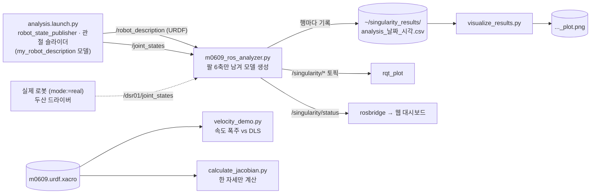
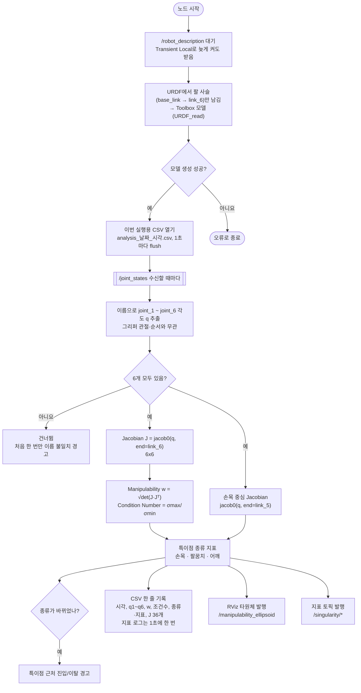
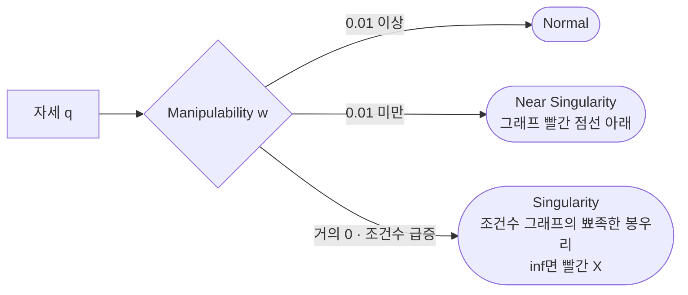

# 🐊 singularity_analysis
[](https://github.com/yoonheon051/singularity_analysis/actions/workflows/test.yml)

동아대학교 기계공학과 2026-1학기 동역학1분반 취업공결 인정 과제

ROS2 Humble 기반의 6축 산업용 로봇(M0609) 의 Jacobian 행렬을 실시간으로 계산하고,
Manipulability / Condition Number 기반으로 Singularity(특이점) 를 분석하는 프로젝트입니다.

본 프로젝트는 다음 기능을 제공합니다.

- 실시간 /joint_states 구독
- Jacobian Matrix 계산
- Manipulability 분석
- Condition Number 분석
- 특이점 감지
- CSV 로그 저장
- 분석 결과 시각화
- **실시간 웹 대시보드**: 특이점 근접도(%)·물리량·도달 예상 시간·벗어나는 방향 ([실시간 대시보드](#실시간-대시보드))
- **실제 M0609 연동**: 두산 드라이버의 관절값으로 그대로 분석 ([실제 로봇에서 실행](#실제-로봇에서-실행))

2026.04.24 현재, m0609 6축 로봇팔만 지원합니다. M0609 시뮬레이션(RViz2)용 로봇 모델 패키지 `my_robot_description`도 이 저장소에 함께 들어 있어서, **저장소 하나로 시뮬레이션부터 분석까지** 실행할 수 있습니다. (예전 별도 저장소 [my_robot_description](https://github.com/yoonheon051/my_robot_description)의 내용을 옮겨 왔습니다.)

## 개발환경
OS: UBUNTU 22.04.05 LTS

Framework: ROS2 Humble

Language: Python 3.10.12

Key Library: NumPy 1.24.4, Roboticstoolbox-python, PyKDL, pandas·matplotlib(시각화)

## 빠른 시작

```bash
# 1. 워크스페이스에 받기
mkdir -p ~/colcon_ws/src && cd ~/colcon_ws/src
git clone https://github.com/yoonheon051/singularity_analysis.git

# 2. 의존성 설치 (ROS 패키지는 rosdep, Robotics Toolbox 는 pip)
cd ~/colcon_ws
rosdep install -i --from-path src --rosdistro humble -y
pip install -r src/singularity_analysis/requirements.txt

# 3. 빌드
colcon build --packages-select my_robot_description singularity_analysis
source install/setup.bash

# 4. 실행: 로봇 모델 + 관절 슬라이더 + RViz(타원체 표시) + 분석 노드
ros2 launch singularity_analysis analysis.launch.py
```

관절 슬라이더로 로봇을 움직이면 RViz에 가동성 타원체가 실시간으로 보이고, 결과는 `~/singularity_results/`에 쌓입니다.
브라우저로 **http://localhost:8080** 을 열면 실시간 대시보드가 보입니다(rosbridge 가 필요하며 2번의 rosdep 이 `ros-humble-rosbridge-suite` 를 설치해 줍니다).
자세한 실행 옵션은 [전체 실행 순서](#전체-실행-순서)를 보세요.

## 파일 구성
저장소 하나에 ROS2 패키지 두 개가 들어 있습니다.

```
singularity_analysis/                  # 저장소 (~/colcon_ws/src 에 clone)
├── README.md, requirements.txt, docs/ # 설명, pip 의존성, README 예시 그림
├── my_robot_description/              # [패키지] M0609·RG2 로봇 모델 (ament_cmake)
│   ├── urdf/                          #   m0609.urdf.xacro (팔만), m0609_rg2.urdf.xacro (RG2 그리퍼 포함)
│   ├── meshes/                        #   RViz 표시용 3D 모델
│   ├── launch/rviz_sim.launch.py      #   모델만 띄워 보기
│   └── rviz/
└── singularity_analysis/              # [패키지] 특이점 분석 (ament_python)
    ├── launch/analysis.launch.py      #   시뮬레이션 + 분석 한 번에 실행
    ├── rviz/analysis.rviz             #   로봇 모델 + 타원체(MarkerArray) 표시 설정
    ├── dashboard/index.html           #   실시간 웹 대시보드 (외부 라이브러리 없음)
    ├── singularity_analysis/          #   파이썬 모듈
    │   ├── singularity.py             #     공통 계산: 타원체, 특이점 종류, URDF 정리 (NumPy만 사용)
    │   ├── m0609_ros_analyzer.py      #     실시간 분석 노드        (ros2 run ... analyzer)
    │   ├── calculate_jacobian.py      #     한 자세 분석            (ros2 run ... calculate_jacobian)
    │   ├── plot_ellipsoid.py          #     자세별 타원체 그림      (ros2 run ... plot_ellipsoid)
    │   ├── velocity_demo.py           #     속도 폭주 vs DLS       (ros2 run ... velocity_demo)
    │   ├── visualize_results.py       #     CSV 그래프             (ros2 run ... visualize_results)
    │   └── dashboard_server.py        #     대시보드 웹 서버        (ros2 run ... dashboard)
    └── test/                          #   검증 테스트 (ROS 없이 실행, 아래 '테스트' 참고)
```

결과(CSV·그림)는 `~/singularity_results/`에 저장합니다. 다른 곳에 두려면 환경변수 `SINGULARITY_RESULTS_DIR`을 지정하거나, launch 에서 `results_dir:=경로`를 줍니다.

### 모델 파일 출처
`my_robot_description/meshes/`의 3D 모델은 두산로보틱스 M0609, OnRobot RG2, Robotiq 그리퍼의 모델 파일입니다. 각 제조사·배포처에 권리가 있으니, 다시 배포할 때는 원래 배포처의 라이선스를 확인하고 출처를 밝혀 주세요. (두 `package.xml`의 라이선스 항목은 아직 `TODO`입니다.)

## 프로젝트 의도

### 1. 실시간 Jacobian 데이터 연산 및 획득
 - Kinematic Tree 구축: 로봇의 URDF 파일로부터 KDL(Kinematics and Dynamics Library) 트리를 생성하여 수학적 연산 기반 마련.
 - 데이터 획득 기법:
    - Roboticstoolbox(rtb): get_jacobian_matrix()를 호출하여 현재 포즈에 대한 $6 \times 6$ Geometric Jacobian 획득.
    - Numerical Analysis: 실시간 관절 각도($q$)를 입력으로 하여 Jacobian 행렬($J(q)$)을 즉시 산출.

### 2. 가동성 타원체(Manipulability Ellipsoid)를 통한 특이점(Singularity) 가시화
로봇 말단(End-effector)의 운동 성능을 기하학적으로 해석합니다.
- 특이점 판별: 
    - Normal State: 타원체가 구(Sphere)에 가까운 형태를 유지하며 모든 방향으로 균등한 이동성 확보.
    - Near Singularity: 타원체가 특정 축으로 편평(Flattened)해지며, 해당 방향으로의 속도 생성이 불가능한 물리적 한계점 분석.
- 구현: `plot_ellipsoid.py`(3D 그림)와 실시간 노드의 RViz 마커. 자세한 내용은 [가동성 타원체](#가동성-타원체-manipulability-ellipsoid)

### 3. 특이점 종류 분류 (손목 / 팔꿈치 / 어깨)
"특이점이다"를 넘어 **왜** 특이점인지(어느 관절 조합이 자유도를 잃었는지)를 구분합니다. 자세한 내용은 [특이점 종류 분류](#특이점-종류-분류)

### 4. 매칭 테이블
```
--------------------------------------------------------------------------------
항목            | 실제 구현 파일           | 구현 방식
--------------------------------------------------------------------------------
Kinematic Tree | m0609_ros_analyzer.py | Toolbox URDF_read()로 모델 생성 (예전 버전은 ERobot.URDF)
--------------------------------------------------------------------------------
실시간 데이터 획득 | m0609_ros_analyzer.py | /joint_states 토픽 구독 및 실시간 연산
--------------------------------------------------------------------------------
Jacobian 산출   | calculate_jacobian.py | jacob0(q, end='link_6')로 6x6 행렬 생성
--------------------------------------------------------------------------------
특이점 분석 지표  |     singularity.py     | √det(J·Jᵀ), np.linalg.cond() 활용
--------------------------------------------------------------------------------
가동성 타원체     | plot_ellipsoid.py     | SVD(J = UΣVᵀ): 축 방향 U, 반지름 σ
               | m0609_ros_analyzer.py | RViz MarkerArray (/manipulability_ellipsoid)
--------------------------------------------------------------------------------
특이점 종류 분류  |     singularity.py     | det(J) = det(J11)·det(J22) 분해
--------------------------------------------------------------------------------
결과 저장        | m0609_ros_analyzer.py | 실행마다 ~/singularity_results/analysis_날짜_시각.csv
--------------------------------------------------------------------------------
지표 토픽        | m0609_ros_analyzer.py | /singularity/* (rqt_plot 실시간 그래프)
--------------------------------------------------------------------------------
속도 폭주 / DLS  |   velocity_demo.py    | J⁻¹ vs 속도 제한 vs Jᵀ(JJᵀ+λ²I)⁻¹ 비교
--------------------------------------------------------------------------------
```

## 프로젝트 개요

산업용 로봇은 특정 자세에서 자유도를 일부 잃게 되는 Singularity(특이점) 문제가 발생합니다.

특이점 근처에서는:

1. 특정 방향으로 이동 불가능
2. 제어 오차 급증
3. 속도 명령 폭주
4. 진동 및 불안정성 증가

와 같은 문제가 발생합니다.

본 프로젝트는 Jacobian 기반의 기구학 분석을 통해 이러한 특이점을 실시간으로 탐지하고 시각화합니다.

## 사용 이론

### Jacobian Matrix

로봇의 관절 속도와 말단 속도의 관계:

$\dot{x}$ =J(q) $\dot{q}$

- $\dot{q}$ : Joint Velocity

- $\dot{x}$ : End-effector Velocity

- J(q): Jacobian Matrix

## Manipulability

Yoshikawa Manipulability Index:

w = $\sqrt{\det(JJ^T)}$

- 값이 클수록 좋은 자세
- 0에 가까울수록 특이점 접근

Condition Number

Jacobian의 수치적 안정성:

$\kappa(J) = \frac{\sigma_{max}}{\sigma_{min}}$

- 1에 가까울수록 이상적
- 값이 커질수록 특이점 근접

## 가동성 타원체 (Manipulability Ellipsoid)

관절 속도를 크기 1인 구 $\|\dot{q}\| \le 1$ 안에서 움직일 때, 말단 속도 $\dot{x} = J\dot{q}$ 가 그리는 모양이 타원체입니다.
특이값 분해 $J = U \Sigma V^T$ 에서

- 타원체의 **축 방향** = $U$ 의 열벡터
- 타원체의 **반지름** = 특이값 $\sigma_1 \ge \sigma_2 \ge \sigma_3$
- Manipulability $w = \prod \sigma_i$ (타원체 부피에 비례), 조건수 $= \sigma_{max} / \sigma_{min}$ (얼마나 납작한지)

가장 짧은 축 $U$ 의 마지막 열이 **가장 움직이기 어려운 방향**이고, 특이점에서는 그 반지름이 0이 됩니다.

### 왜 타원체를 둘로 나누어 그리나
말단 전체의 선속도 타원체($J$ 의 위 3행)나 각속도 타원체(아래 3행)만 보면, 특이점에서도 다른 관절이 조금씩 메워 줘서 0까지 줄지 않습니다.
예를 들어 손목 특이점($q_5 = 0.05$)에서 말단 각속도 타원체의 가장 짧은 반지름은 1.15 → 0.72 로 줄어드는 정도입니다.
그래서 아래 [특이점 종류 분류](#특이점-종류-분류)와 같은 방식으로 나눕니다.

- **ARM 타원체**: 팔(1~3축)이 손목 중심을 움직이는 선속도, $J_{11}$ (3x3) → 팔꿈치·어깨 특이점에서 납작해짐
- **WRIST 타원체**: 손목(4~6축)이 손을 돌리는 각속도, $J_{22} = [z_4\ z_5\ z_6]$ (3x3) → 손목 특이점에서 납작해짐


| 자세 | 분류 | ARM 반지름 | WRIST 반지름 |
|---|---|---|---|
| 정상 (0, -0.3, 1.2, 0, 1.0, 0) | normal | 0.714, 0.197, 0.167 | 1.241, 1.000, 0.678 |
| 손목 근처 ($q_5$ = 0.05) | wrist | 0.714, 0.197, 0.167 | 1.414, 1.000, **0.035** |
| 팔꿈치 근처 ($q_3$ = 0.05) | elbow | 0.861, 0.389, **0.009** | 1.241, 1.000, 0.678 |
| 어깨 근처 ($q_2$ = -0.65, $q_3$ = 1.5) | shoulder | 0.636, 0.237, **0.028** | 1.241, 1.000, 0.678 |

특이점 종류마다 **해당 타원체 하나만** 납작해지고, 다른 하나는 정상 자세와 같습니다.

## 특이점 종류 분류

M0609는 4·5·6번 관절 축이 한 점(손목 중심, `link_5` 원점)에서 만나는 **구형 손목(spherical wrist)** 구조입니다.
손목 중심 $p_{wc}$ 를 기준점으로 Jacobian을 쓰면 블록 삼각행렬이 되고, 기준점을 말단으로 옮겨도 행렬식은 같으므로

$$\det J = \det J_{11} \cdot \det J_{22}$$

- $J_{11} = [c_1\ c_2\ c_3]$, $c_i = z_i \times (p_{wc} - p_i)$ : 팔 3축이 손목 중심을 움직이는 선속도
- $J_{22} = [z_4\ z_5\ z_6]$ : 손목 3축의 회전축

또 $\det J_{11} = c_1 \cdot (c_2 \times c_3) = (c_1 \cdot n)\,\|c_2 \times c_3\|$ ($n$ = $c_2 \times c_3$ 방향 단위벡터) 이므로, 행렬식이 0이 되는 경우는 세 가지입니다.

| 종류 | 조건 | 지표 (0이면 특이점) | 임계값 | 물리적 의미 |
|---|---|---|---|---|
| 손목 (wrist) | $\det[z_4\ z_5\ z_6] = 0$ | $\lvert\det[z_4\ z_5\ z_6]\rvert$ | 0.10 | 4·6번 축이 일직선 ($q_5 \approx 0$, 약 ±5.7° 이내) → 손을 돌리는 축 하나를 잃음 |
| 팔꿈치 (elbow) | $c_2 \parallel c_3$ | $\sin\angle(c_2, c_3)$ | 0.10 | 팔이 완전히 펴지거나 접힘 → 팔 방향으로 더 못 늘어남 |
| 어깨 (shoulder) | $c_1 \cdot n = 0$ | $\lvert c_1 \cdot n \rvert$ / 팔 길이(0.779 m) | 0.05 | 손목 중심이 1번 축 쪽으로 옴 → 1번 관절이 새 방향을 못 만들어 옆으로 못 움직임 |

임계값은 my_robot_description의 M0609 URDF로 각도를 바꿔 가며 정했습니다(`singularity.py`의 `*_LIMIT`).
수치 확인 결과 $\det J$ 와 $\det J_{11} \cdot \det J_{22}$ 는 $q_4 = 0$ 인 자세에서 완전히 같고, 일반 자세에서는 상대 오차 $10^{-4}$ 수준으로 같습니다. URDF에 90° 회전이 `1.571`(π/2의 근사)로 적혀 있어 손목 세 축이 약 0.03 mm 어긋나기 때문입니다(실제 로봇도 조립 오차가 있어 완벽한 구형 손목은 아닙니다).

계산은 `singularity.py`에 있고, Toolbox로 `jacob0(q, end='link_6')`(말단)과 `jacob0(q, end='link_5')`(손목 중심) 두 Jacobian만 있으면 됩니다.
`link_5`가 없는 URDF에서는 종류 분류를 건너뛰고 경고를 띄웁니다.

## 속도 명령 폭주와 감쇠 최소제곱 (DLS)

[프로젝트 개요](#프로젝트-개요)의 "속도 명령 폭주"를 직접 보여 주는 시뮬레이션입니다(`velocity_demo.py`, ROS 없이 URDF만 사용).

**상황**: 말단 자세(방향)는 고정하고 아래로 25 cm를 5 cm/s로 직선 이동합니다. 이 경로는 $q_5$ 를 0.3 rad에서 0을 지나 −0.3 rad까지 끌고 가서 **손목 특이점을 통과**합니다.
매 순간 원하는 말단 속도 $\dot{x}$ (경로 속도 + 오차 보정)를 관절 속도로 바꾸는 방법 세 가지를 비교했습니다.

| 방법 | 식 | 최대 관절 속도 | 최대 경로 오차 |
|---|---|---|---|
| 역행렬 | $\dot{q} = J^{-1}\dot{x}$ | **5,558 rad/s** | 0.63 mm |
| 역행렬 + 관절 속도 제한 (2.618 rad/s) | 위 $\dot{q}$ 를 비율 축소 | 2.62 rad/s | **54.7 mm** |
| 감쇠 최소제곱 (DLS) | $\dot{q} = J^T (JJ^T + \lambda^2 I)^{-1} \dot{x}$ | **0.21 rad/s** | 0.49 mm |

- **역행렬**: 특이점에서 $J^{-1}$ 이 무한대로 커져, 아주 짧은 순간 4·6번 관절이 반대 방향으로 약 두 바퀴(±12.6 rad)씩 돕니다. 실제 로봇이라면 속도 한계(M0609 URDF 기준 2.618 rad/s)의 2,000배가 넘는 명령입니다.
- **역행렬 + 속도 제한**: 실제 제어기처럼 속도를 막으면 폭주는 없지만, 그 사이 경로를 못 따라가 5 cm 넘게 벗어납니다.
- **DLS**: 최소 특이값이 $\varepsilon$ 보다 작아질 때만 $\lambda^2 = \left(1 - (\sigma_{min}/\varepsilon)^2\right)\lambda_{max}^2$ 로 감쇠를 켭니다(Nakamura·Chiaverini 방식). 못 움직이는 방향의 속도를 조금 포기하는 대신 관절 속도를 작게 유지합니다.
- **감쇠의 대가**: $\varepsilon = 0.1$, $\lambda_{max} = 0.15$ 로 감쇠를 키우면 관절 속도는 비슷하지만(0.20 rad/s) 경로 오차가 5.1 mm로 커집니다. 안전(속도)과 정확도(오차) 사이의 균형을 $\lambda$ 로 고르는 것입니다.


## 파일 별 상세 설명

### calculate_jacobian.py
Jacobian 계산 및 기구학 분석을 수행하는 핵심 분석 파일입니다.

주요기능

1. Forward Kinematics 계산

```
T = robot.fkine(q)
```
입력된 관절 각도로부터 End-effector Pose 계산

2. Jacobian Matrix 계산

```
J = robot.jacob0(q)
```
Base Frame 기준의 Geometric Jacobian 계산

3. Manipulability 계산

```
w = robot.manipulability(q)
```
현재 자세의 가동성 평가

4. Condition Number 계산

```
cond = np.linalg.cond(J)
```
특이점 근접 여부 분석

5. Wrist Singularity 테스트

```
--q 0 0 1.5708 0 0.01 0   (기본값)
```
5번 관절(q5)을 0 근처로 설정하여 Wrist Singularity를 인위적으로 생성. 다른 자세는 `--q`로 6개 각도(rad)를 넘깁니다.

6. 실행 방법

URDF 경로를 생략하면 `my_robot_description` 패키지의 `urdf/m0609.urdf.xacro`를 씁니다. 다른 URDF/xacro 파일은 경로로 줍니다.

```
ros2 run singularity_analysis calculate_jacobian
ros2 run singularity_analysis calculate_jacobian --q 0 -0.3 1.2 0 1.0 0   # 다른 자세
ros2 run singularity_analysis calculate_jacobian 다른로봇.urdf
```
빌드하지 않고 저장소에서 바로 실행해도 됩니다: `python3 singularity_analysis/singularity_analysis/calculate_jacobian.py`

7. 실행 예시 (기본 자세, my_robot_description의 m0609 URDF 기준)

```
Joint angles (rad): [0.0, 0.0, 1.571, 0.0, 0.01, 0.0]
Jacobian Matrix:
[[ ... ]]
Determinant: -0.000557
Manipulability Index: 0.000557
Condition Number: 797.47
Singularity indices (0 = singular): wrist=0.010  elbow=...  shoulder=...
Singularity type: wrist
Hardest linear direction (base frame): [...]
Hardest rotation axis (base frame): [...]
```
같은 URDF에서 특이점이 아닌 자세(`--q 0 -0.3 1.2 0 1.0 0`)는 Manipulability 0.0198, Condition Number 20.1 정도로, 손목 특이점 근처보다 조건수가 약 40배 작습니다.

### m0609_ros_analyzer.py
ROS2 기반 실시간 특이점 분석 노드입니다.

프로젝트의 핵심 실행 파일입니다.

주요 역할

1. /robot_description 구독

```
self.create_subscription(
    String,
    '/robot_description',
    ...
)
```

2. URDF 기반 Robot Model 생성

```
self.robot = load_robot_from_xml(self.urdf_xml)   # 팔 6축만 남겨 Toolbox 모델로 (URDF_read)
```
URDF → Kinematic Model 변환

3. /joint_states 실시간 구독

```
self.create_subscription(
    JointState,
    '/joint_states',
    ...
)
```
현재 관절 각도 수신

4. Jacobian·지표·특이점 종류 실시간 계산 (`singularity.py`)

```
a = sg.analyze(self.robot, q, end='link_6', wrist='link_5')
```
- Jacobian: `jacob0(q, end='link_6')` (6x6)
- Manipulability: $\sqrt{\det(JJ^T)}$, Condition Number: `np.linalg.cond(J)`
- 특이점 종류: 손목·팔꿈치·어깨 지표 ([특이점 종류 분류](#특이점-종류-분류))

5. 터미널 로그

- 지표는 1초에 한 번 출력 (`/joint_states`가 수십 Hz라 매번 찍으면 넘침)
- 특이점 근처에 **들어가거나 나오는 순간** 경고: `특이점 근처 진입: elbow (지표: wrist=0.841, elbow=0.026, shoulder=0.500)`

6. RViz 가동성 타원체

RViz에서 **Add → By topic → `/manipulability_ellipsoid` → MarkerArray** 를 추가하면, 손목 중심에 타원체 두 개가 보입니다.
- `arm` (팔 1~3축 선속도): 팔꿈치·어깨 특이점 근처에서 납작해지고 빨간색
- `wrist` (손목 4~6축 각속도): 손목 특이점 근처에서 납작해지고 빨간색
- 크기는 반지름 × 0.3 m (`ELLIPSOID_SCALE`)

지표 토픽도 함께 발행합니다. `rqt_plot`으로 실시간 그래프를 보거나, 다른 노드가 구독해 경고·감속에 쓸 수 있습니다.

| 토픽 | 타입 | 내용 |
|---|---|---|
| `/singularity/manipulability` | `std_msgs/Float64` | Manipulability $w$ |
| `/singularity/condition_number` | `std_msgs/Float64` | 조건수 (완전 특이면 inf) |
| `/singularity/sigma_min` | `std_msgs/Float64` | 최소 특이값 |
| `/singularity/type` | `std_msgs/String` | `normal` / `wrist` / `elbow` / `shoulder` / 겹치면 `wrist+elbow` |
| `/singularity/status` | `std_msgs/String` | 대시보드용 종합 상태(JSON, 기본 15 Hz). [실시간 대시보드](#실시간-대시보드) 참고 |

노드 파라미터 (launch 가 알아서 넣어 주므로 직접 쓸 일은 드뭅니다)

| 파라미터 | 기본값 | 설명 |
|---|---|---|
| `joint_states_topic` | `/joint_states` | 관절 상태 토픽. 두산 드라이버는 보통 `/dsr01/joint_states` |
| `robot_description_topic` | `/robot_description` | URDF 를 받을 토픽 |
| `urdf_file` | (빈 값) | 주면 토픽을 기다리지 않고 이 URDF/xacro 파일로 모델을 만듦 |
| `status_rate_hz` | `15.0` | `/singularity/status` 발행 빈도 (0 이하면 매 메시지) |
| `warn_factor` | `3.0` | 근접도 0% 가 되는 지점 = 임계값 × 이 값 |
| `results_dir` | `~/singularity_results` | CSV 저장 폴더 |

```
ros2 run rqt_plot rqt_plot /singularity/manipulability/data /singularity/sigma_min/data
ros2 topic echo /singularity/type
```

7. CSV 자동 저장

```
~/singularity_results/analysis_20261120_153000.csv   (실행할 때마다 새 파일)
```

다음 데이터를 저장:

- Timestamp
- q1 ~ q6
- Manipulability
- Condition Number
- 특이점 종류(`normal` / `wrist` / `elbow` / `shoulder` / 겹치면 `wrist+elbow`), 최소 특이값, 손목·팔꿈치·어깨 지표
- 6x6 Jacobian Matrix

실행할 때마다 새 파일을 만들어 실행끼리 섞이지 않습니다. 파일은 열어 둔 채로 쓰고 1초마다 디스크에 내보내며(`/joint_states`가 수십 Hz라 매번 열고 닫지 않음), 노드를 끌 때 닫습니다.

8. 저장되는 CSV 예시

```
--------------------------------------------------------------------------------------------------------------------------------
timestamp | q1  | ... | q6  | manipulability | condition_number | singularity_type | sigma_min | wrist_idx | elbow_idx | shoulder_idx
--------------------------------------------------------------------------------------------------------------------------------
12:34:56  | 0.0 | ... | 0.0 |     0.0198     |       20.1       |      normal      |   0.12    |   0.841   |   0.595   |    0.214
12:34:57  | 0.0 | ... | 0.0 |     0.0012     |      270.6       |      wrist       |   0.004   |   0.050   |   0.595   |    0.214
--------------------------------------------------------------------------------------------------------------------------------
```

### visualize_results.py
수집된 분석 데이터를 그래프로 시각화합니다.

주요 기능

1. Manipulability 그래프

```
ax1.plot(df['manipulability'])
```
- 값 감소 → 특이점 접근
- V자 형태 → 위험 구간

2. Condition Number 그래프

```
ax2.plot(df['condition_number'])
```
- 값 급증 → 제어 불안정
- 로그 스케일 사용

3. 특이점 임계값 표시

```
ax1.axhline(y=0.01)
```

4. 특이점 종류 구간 색칠 + 지표 그래프 (새 CSV)

- 위 두 그래프의 배경을 특이점 종류별로 색칠 (손목: 주황, 팔꿈치: 보라, 어깨: 청록)
- 세 번째 그래프: 손목·팔꿈치·어깨 지표와 임계값(점선)

5. 실행 방법

```
ros2 run singularity_analysis visualize_results
```

6. 출력 결과 (CSV 옆에 `analysis_날짜_시각_plot.png`로도 저장)

- Manipulability 그래프
- Condition Number 그래프
- 특이점 종류 지표 그래프 (새 CSV)

아래는 손목 → 팔꿈치 → 어깨 특이점을 차례로 지나가는 동작의 예시입니다. 색칠된 구간마다 해당 지표 하나만 0으로 떨어집니다.


### plot_ellipsoid.py
여러 자세의 가동성 타원체를 3D로 나란히 그립니다. ROS 없이 URDF만 있으면 됩니다.

```
ros2 run singularity_analysis plot_ellipsoid                         # 기본 4자세: 정상·손목·팔꿈치·어깨 특이점 근처
ros2 run singularity_analysis plot_ellipsoid --q 0 -0.3 1.2 0 1 0 --q 0 0 0 0 0 0   # 원하는 자세 여러 개
```
- 윗줄: ARM 타원체, 아랫줄: WRIST 타원체 ([왜 둘로 나누나](#왜-타원체를-둘로-나누어-그리나))
- 빨간 화살표: 가장 움직이기 어려운 방향(가장 짧은 축)
- 결과: `~/singularity_results/manipulability_ellipsoids.png`

### velocity_demo.py
특이점을 지나가는 직선 경로에서 역행렬 / 역행렬 + 속도 제한 / DLS의 관절 속도와 경로 오차를 비교합니다([설명](#속도-명령-폭주와-감쇠-최소제곱-dls)).

```
ros2 run singularity_analysis velocity_demo
ros2 run singularity_analysis velocity_demo --eps 0.1 --lam 0.15   # 감쇠를 키워 정확도와의 균형 비교
```
- 터미널: 방법별 최대 관절 속도·위치 오차·자세 오차 표
- 결과: `~/singularity_results/velocity_dls_demo.png` (관절 속도, 경로 오차, 최소 특이값과 λ, 손목 관절 각도)

## 전체 실행 순서

### 1. 설치·빌드 (처음 한 번)

```bash
source /opt/ros/humble/setup.bash
mkdir -p ~/colcon_ws/src && cd ~/colcon_ws/src
git clone https://github.com/yoonheon051/singularity_analysis.git
cd ~/colcon_ws
rosdep install -i --from-path src --rosdistro humble -y
pip install -r src/singularity_analysis/requirements.txt
colcon build --packages-select my_robot_description singularity_analysis
source install/setup.bash
```
코드를 고친 뒤에는 `colcon build --packages-select singularity_analysis --symlink-install`로 다시 빌드합니다(`--symlink-install`이면 이후 파이썬 수정은 다시 빌드하지 않아도 반영됩니다).

### 2. 시뮬레이션 + 분석 실행

```bash
ros2 launch singularity_analysis analysis.launch.py
```

| 옵션 | 기본값 | 설명 |
|---|---|---|
| `model:=` | `m0609_rg2` | 로봇 모델. `m0609`(그리퍼 없음) 또는 `m0609_rg2`(RG2 그리퍼 포함) |
| `gui:=` | `true` | 관절 슬라이더 창 (`mode:=real` 이면 항상 끔) |
| `rviz:=` | sim: `true`, real: `false` | RViz (로봇 모델 + 가동성 타원체) |
| `results_dir:=` | `~/singularity_results` | CSV 저장 폴더 |
| `mode:=` | `sim` | `real` 이면 실제 로봇 ([실제 로봇에서 실행](#실제-로봇에서-실행)) |
| `joint_states_topic:=` | sim: `/joint_states`, real: `/dsr01/joint_states` | 관절 상태 토픽 |
| `dashboard:=` | `true` | rosbridge + 대시보드 웹 서버 실행 |
| `dashboard_port:=` / `rosbridge_port:=` | `8080` / `9090` | 웹 페이지 / WebSocket 포트 |
| `status_rate_hz:=` | `15.0` | 대시보드 갱신 빈도 |

그리퍼 모델이어도 분석은 팔 6축(base_link → link_6)만 대상으로 하고, 관절값은 이름(`joint_1`~`joint_6`)으로 찾습니다.
로봇 모델만 보려면 `ros2 launch my_robot_description rviz_sim.launch.py`도 그대로 쓸 수 있습니다.

### 3. 로봇 움직이기

관절 슬라이더 창(또는 실제 로봇)에서 관절 값을 바꿉니다. 특이점 근처에 들어가면 터미널에 경고가 뜨고, RViz의 타원체가 납작해지며 빨갛게 바뀝니다.

### 4. CSV 결과 확인

```
~/singularity_results/analysis_날짜_시각.csv   (노드 시작 시 터미널에 경로가 찍힘)
```

### 5. 결과 시각화

```bash
ros2 run singularity_analysis visualize_results
```
인자 없이 실행하면 결과 폴더에서 **가장 최근 실행의 CSV**를 그립니다. 그래프는 화면에 띄우고 CSV 옆에 `..._plot.png`로도 저장합니다. 다른 실행을 보려면 경로를 줍니다(`ros2 run singularity_analysis visualize_results ~/singularity_results/analysis_20261120_153000.csv`).

### 6. (선택) 지표 실시간 그래프

```bash
ros2 run rqt_plot rqt_plot /singularity/manipulability/data /singularity/sigma_min/data
```

### 7. (선택) ROS 없이 하는 분석

```bash
ros2 run singularity_analysis plot_ellipsoid      # 자세별 타원체 그림
ros2 run singularity_analysis velocity_demo       # 속도 폭주 vs DLS
ros2 run singularity_analysis calculate_jacobian  # 한 자세 분석
```
빌드하지 않고 `python3 singularity_analysis/singularity_analysis/plot_ellipsoid.py`처럼 파일을 바로 실행해도 됩니다.

### 8. 테스트

ROS 없이 도는 테스트 53개와, Robotics Toolbox가 있을 때 추가로 도는 교차 검증 14개입니다. Robotics Toolbox 대신, 같은 M0609 URDF로 직접 만든 NumPy 기구학(`test/conftest.py`의 `ReferenceRobot`)을 쓰고, 분석 노드는 가짜 `rclpy`로 처음부터 실행합니다.

```bash
python3 -m pytest singularity_analysis/test -v      # 저장소 최상위에서
colcon test --packages-select singularity_analysis && colcon test-result --verbose   # 또는 colcon 으로
```

| 파일 | 확인하는 것 |
|---|---|
| `test_singularity.py` | URDF 정리(그리퍼·미믹 관절 제거), Jacobian vs 수치미분, 행렬식 분해, 특이점 분류, 타원체가 해당 종류에서만 납작해지는지, DLS 관절 속도 |
| `test_analyzer.py` | 분석 노드: 그리퍼 URDF로 6축 모델 생성, 관절을 이름으로 찾기(순서가 섞이고 그리퍼 관절이 있어도), CSV 기록·flush·닫기, 지표 토픽 = CSV, 타원체 마커 위치·색, 종류가 바뀔 때만 경고, 관절 이름 불일치 경고 1회, 잘못된 URDF면 빈 CSV 없이 종료 |
| `test_scripts.py` | `visualize_results`(새 CSV·예전 CSV+inf, 최신 CSV 고르기), `calculate_jacobian`, `plot_ellipsoid`(기본 4자세가 의도한 종류로 분류), `velocity_demo`가 끝까지 돌고 결과 파일을 남기는지 |
| `test_dashboard.py` | 물리량·근접도·도달 예상 시간·벗어나는 방향 계산, 기울기 vs 중앙 차분, 상태 JSON 에 inf 가 없는지, 분석 노드의 `/singularity/status`·빈도 제한·관절 속도(메시지 값/차분 추정), 관절별 위험도·도달 예상 시간(관여 관절만), 로봇팔 그림용 관절 위치·축(순기구학·Jacobian 과 일치, M0609 치수), 실제 로봇 파라미터(관절 토픽·URDF 파일), 대시보드 웹 서버 |
| `test_toolbox.py` | **실제 Robotics Toolbox**와 교차 검증: fkine·Jacobian이 `ReferenceRobot`과 같은지, 분석 결과가 같은지, 원본 URDF의 끝 링크가 둘(`base`, `tool0`)인지, RG2 xacro가 6축으로 불러와지는지, README의 DLS 숫자가 재현되는지, deprecated 된 `Robot.URDF()`를 부르지 않는지. Toolbox를 불러올 수 없으면 건너뜀 |

**자동 테스트(GitHub Actions)**: push할 때마다 `.github/workflows/test.yml`이 Ubuntu 22.04 + Python 3.10(ROS2 Humble과 같은 환경)에서 Robotics Toolbox까지 설치해 전체 테스트를 돌립니다. 결과는 README 맨 위 배지와 저장소의 **Actions** 탭에서 볼 수 있습니다.

## 실시간 대시보드

분석 노드가 `/singularity/status`(JSON)를 발행하면, rosbridge 가 WebSocket(9090)으로 넘기고, 브라우저 페이지(8080)가 그립니다.
`analysis.launch.py` 가 셋 다 띄우므로 **http://localhost:8080** 만 열면 됩니다. 같은 네트워크의 태블릿·폰에서는 `http://<PC IP>:8080`.


화면은 **관절(J1~J6) 기준**입니다. 분석 코드의 특이점 종류(손목·팔꿈치·어깨)는 화면에서 "어느 관절들의 문제인가"로 바꿔 부릅니다.

- **로봇팔 (맨 위)**: 현재 관절각으로 그린 M0609. 관절은 회전축 방향의 원통으로 그리고, 색은 관절 위험도에 따라 **초록(안전) → 노랑 → 빨강(특이점 근처)**. 벗어나려면 돌릴 관절은 점선 원과 `+`/`−` 로 표시. 드래그로 돌려 보고, 더블클릭하면 처음 시점
- **전체 위험도**: 안전 / 주의 / 위험 + 0~100%, 가장 위험한 관절과 이유(예: "J4·J6 회전축이 거의 일직선"), "이 속도면 N초 후 임계 도달", 벗어나는 방향
- **관절 카드 J1~J6**: 각도, 위험도(색·%), 도달 예상 시간. 벗어나려면 돌릴 관절은 빨간 점선 테두리와 "+ 방향으로 돌리면 멀어짐"
- **최근 30초 관절 위험도 그래프** (마우스를 올리면 값)
- **위험 조건**: 아래 세 조건의 물리량과 임계값, 근접도

관절 위험도는 그 관절이 걸린 조건의 근접도입니다(`singularity.py`의 `KIND_JOINTS`, `joint_risk`, `joint_eta`). 한 관절이 여러 조건에 걸리면 가장 큰 값을 씁니다.

| 화면 이름 (분석 코드) | 조건 | 물리량 | 색이 바뀌는 관절 |
|---|---|---|---|
| J4·J5·J6 (wrist) | det[z₄ z₅ z₆] = 0 | J4·J6 회전축 사이 각 (J5 ≈ 0°) | J4·J5·J6 |
| J2·J3 (elbow) | c₂ ∥ c₃ | 팔이 다 펴지거나 접히기까지 남은 각 | J2·J3 |
| J1 (shoulder) | c₁ · n = 0 | 손목 중심 ↔ J1 회전축 거리 | J1 |

### 근접도·물리량
지표(0이면 특이점)를 사람이 읽기 쉬운 값으로 바꿉니다(`singularity.py`의 `physical_value`, `proximity`).

| 종류 | 물리량 | 임계값 (근접도 100%) | 경고 시작 (근접도 0%) |
|---|---|---|---|
| 손목 | 4·6번 축 사이 각 = asin(지표) | 5.7° | 17.5° |
| 팔꿈치 | c₂·c₃ 사이 각 = asin(지표) (팔이 펴짐/접힘까지 남은 각) | 5.7° | 17.5° |
| 어깨 | 손목 중심 ↔ 1번 축 거리 ≈ 지표 × 팔 길이 | 3.9 cm | 11.7 cm |

근접도 = (경고 시작 − 지표) / (경고 시작 − 임계값), 0~1 로 자름. 경고 시작 = 임계값 × `warn_factor`(3). 100% 가 곧 기존 특이점 분류(`classify`)의 경계라 CSV 의 `singularity_type` 과 일치합니다.

### 도달 예상 시간과 벗어나는 방향
지표의 관절 기울기 $\nabla_q s = \partial s / \partial q$ 를 전진 차분으로 구합니다(Jacobian 12번, 대시보드에 발행할 때만).
- 지표 변화 속도 $\dot{s} = \nabla_q s \cdot \dot{q}$ → 줄어드는 중이면 **도달 예상 시간** = (지표 − 임계값) / $(-\dot{s})$ (30초 이내만 표시)
- 기울기 성분이 가장 큰 관절과 그 부호 → **벗어나는 방향** (예: 손목 특이점이면 q5 를 지금 부호 쪽으로)
- $\dot{q}$ 는 `/joint_states` 의 `velocity`(두산 드라이버·ros2_control 은 채워 줌)를 쓰고, 비어 있으면(관절 슬라이더) 직전 메시지와의 차분을 평활해서 추정합니다.

### `/singularity/status` 형식 (요약)
```
{
  "stamp": 1795400000.12, "q": [6개, rad], "qdot": [6개, rad/s] 또는 null,
  "type": "wrist", "level": "danger", "risk": 1.0, "dominant": "wrist",
  "manipulability": 0.0012, "condition_number": 270.6, "sigma_min": 0.004,
  "kinds": {
    "wrist": {"index": 0.05, "limit": 0.1, "proximity": 1.0, "value": 2.9, "unit": "deg",
              "value_limit": 5.7, "value_warn": 17.5, "rate": -0.09, "eta": null,
              "escape": {"joint": 5, "direction": 1}},
    "elbow": {...}, "shoulder": {...}
  },
  "joint_risk": [0, 0, 0, 1.0, 1.0, 1.0],
  "geometry": {"base": [0, 0, 0], "joints": [[x, y, z] × 6], "axes": [[ax, ay, az] × 6]}
}
```
완전 특이점에서 조건수가 inf 이면 `null` 로 보냅니다(브라우저 JSON 은 Infinity 를 못 읽음).
`joint_risk` 는 관절 J1~J6 의 위험도(0~1), `geometry` 는 로봇팔 그림용 관절 원점 위치(m, base 좌표계)와 회전축 단위벡터입니다(순기구학은 분석 노드가 계산하므로 브라우저는 그리기만 함).

대시보드만 따로 띄우려면 `ros2 run singularity_analysis dashboard --port 8080` (rosbridge 는 `ros2 launch rosbridge_server rosbridge_websocket_launch.xml`). rosbridge 주소가 다르면 `http://PC:8080/?ws=ws://192.168.0.10:9090`.

## 실제 로봇에서 실행

분석은 관절값을 **읽기만** 하고 로봇에 명령을 보내지 않습니다.

```bash
# 1. 두산 드라이버 (doosan-robot2, humble) — 처음에는 mode:=virtual(에뮬레이터)로 연습
ros2 launch dsr_bringup2 dsr_bringup2_rviz.launch.py mode:=real host:=<제어기 IP> model:=m0609

# 2. 관절 토픽 이름 확인 (보통 /dsr01/joint_states, 관절 이름 joint_1 ~ joint_6)
ros2 topic list | grep joint_states
ros2 topic echo --once /dsr01/joint_states

# 3. 분석 + 대시보드
ros2 launch singularity_analysis analysis.launch.py mode:=real
#    토픽이 다르면: ... mode:=real joint_states_topic:=/joint_states
```

`mode:=real` 에서는
- 관절 슬라이더와 이 패키지의 robot_state_publisher·RViz 를 띄우지 않습니다(드라이버가 모델·/tf·RViz 를 맡음). 타원체를 보려면 드라이버의 RViz 에서 **Add → By topic → `/manipulability_ellipsoid`**.
- 분석 모델은 `my_robot_description/urdf/<model>.urdf.xacro` 파일에서 직접 읽습니다(`urdf_file` 파라미터).
- 그리퍼(RG2)를 달아도 특이점 판정(det J)은 기준점 위치와 무관해 그대로입니다. 단, 말단 선속도 타원체·가동성 값은 기준점에 따라 달라집니다.

실제 로봇으로 움직인 기록은 `ros2 bag record /dsr01/joint_states` 로 남겨 두면, 나중에 `ros2 bag play` + `mode:=real` 로 로봇 없이 대시보드를 다시 볼 수 있습니다.

> 확인이 필요한 점: 드라이버의 토픽·관절 이름은 버전에 따라 다를 수 있으니 2번에서 꼭 확인하세요. 또 드라이버의 M0609 모델과 `my_robot_description` 의 치수가 같은지도 한 번 비교해 보는 것이 좋습니다.

## 분석 흐름

### 전체 구성



### 실시간 분석 노드 (`m0609_ros_analyzer.py`)



### 특이점 판단


0.01은 `visualize_results.py`가 그래프에 그리는 경고선 값입니다. 예를 들어 my_robot_description의 M0609에서 q5를 0.8 → -0.8 rad로 움직이면, w는 q5 = 0에서 0으로 떨어지고(V자) 조건수는 10¹⁷ 정도까지 치솟습니다.

### 말단 링크를 `link_6`으로 지정하는 이유
M0609 URDF에는 끝이 열린 링크가 두 개 있습니다. 높이 표시용 `base`(base_link 위 0.45 m)와 말단 `tool0`입니다. Robotics Toolbox는 말단을 지정하지 않으면 그중 **첫 번째**를 말단으로 고르는데, URDF에서 `base`가 먼저 나와서 엉뚱한 Jacobian이 계산될 수 있습니다(터미널에 "More than one end-effector present" 경고가 뜹니다). 그래서 두 스크립트 모두 `link_6`을 명시합니다. `link_6`은 `tool0`과 원점이 같아 `jacob0` 결과가 같습니다.

## 특이점 판단 기준

```
-----------------------------------------------------
상태              | Manipulability | Condition Number
-----------------------------------------------------
Normal           |       큼        | 낮음
-----------------------------------------------------
Near Singularity |    매우 작음     | 매우 큼
-----------------------------------------------------
Singularity      |     0 근접      | infinity
-----------------------------------------------------
```

어떤 **종류**의 특이점인지는 손목·팔꿈치·어깨 지표로 따로 판단합니다([특이점 종류 분류](#특이점-종류-분류)). Manipulability가 0.01 아래로 떨어지지 않아도 지표 하나가 임계값 아래면 그 종류의 특이점 근처로 분류됩니다.
