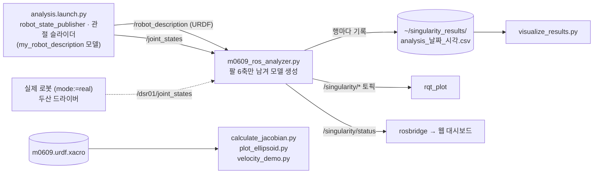
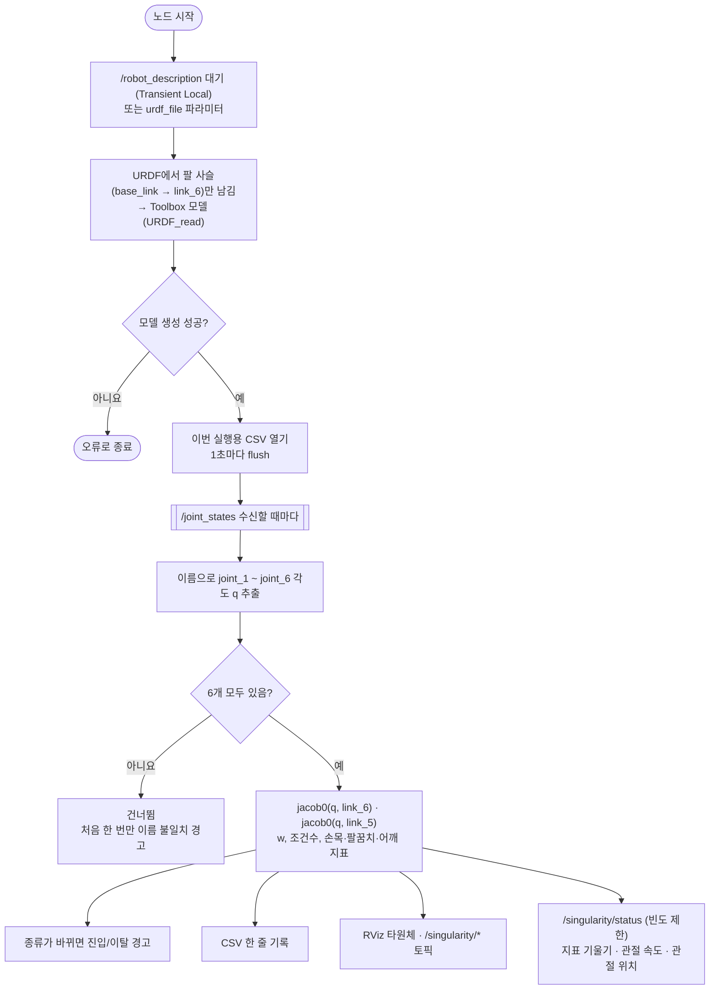

# 개발자 문서

[← README](../README.md)

`setup.sh` 없이 직접 설치하는 방법, 코드 구조와 분석 흐름, 대시보드 데이터 형식, 테스트와 CI 입니다.

- [직접 설치 (setup.sh 없이)](#직접-설치-setupsh-없이)
- [분석 흐름](#분석-흐름)
- [/singularity/status 형식](#singularitystatus-형식)
- [테스트](#테스트)
- [자동 테스트 (GitHub Actions)](#자동-테스트-github-actions)

## 직접 설치 (setup.sh 없이)

`setup.sh` 가 하는 일과 같습니다.

```bash
source /opt/ros/jazzy/setup.bash          # Ubuntu 22.04 는 humble
cd ~/colcon_ws
rosdep install -i -y --from-paths src/singularity_analysis --rosdistro $ROS_DISTRO

# Robotics Toolbox: 워크스페이스 가상환경에 (ROS·apt 패키지도 보이게 --system-site-packages)
sudo apt install python3-venv
python3 -m venv --system-site-packages .venv && touch .venv/COLCON_IGNORE
.venv/bin/pip install -r src/singularity_analysis/requirements.txt "numpy<2"

colcon build --packages-up-to singularity_analysis
source install/setup.bash
# ros2 run/launch 로 띄운 노드는 시스템 python3 로 실행되므로 가상환경 패키지 경로를 직접 넣어 줌
export PYTHONPATH="$(.venv/bin/python -c 'import sysconfig; print(sysconfig.get_paths()["purelib"])'):$PYTHONPATH"
```

- **가상환경을 쓰는 이유**: Ubuntu 24.04 는 시스템 Python 에 pip 설치를 막습니다(`externally-managed-environment`).
- **`activate` 만으로 안 되는 이유**: colcon 이 만든 노드는 시스템 `python3` 로 실행되어 가상환경 패키지를 못 찾습니다. 그래서 마지막 줄처럼 `PYTHONPATH` 를 넣고, `setup.sh` 가 만드는 `env.sh` 가 이 일을 합니다.
- **`numpy<2` 인 이유**: apt 로 설치된 matplotlib·scipy 와 ROS 메시지 라이브러리가 NumPy 1.x 용으로 빌드되어 있어, NumPy 2 가 섞이면 import 하다 죽습니다. Robotics Toolbox 1.5 는 NumPy 2 를 요구하므로 이 조건이면 pip 가 1.4.x 를 고릅니다.
- **ROS 버전을 바꿨을 때**: 다른 버전으로 빌드한 `build/ install/ log/` 는 지우고 다시 빌드해야 합니다(`setup.sh` 는 알아서 함).

## 분석 흐름

### 전체 구성



### 실시간 분석 노드 (`m0609_ros_analyzer.py`)



### 코드 위치

| 내용 | 파일 | 구현 |
|---|---|---|
| 공통 계산 (지표, 분류, 타원체, 근접도, 상태 JSON) | `singularity.py` | NumPy 만 사용. `analyze`, `classify`, `proximity`, `index_gradient`, `build_status` |
| 모델 생성 | `singularity.py` | URDF 에서 팔 6축만 남겨 Toolbox `URDF_read` |
| 실시간 노드 | `m0609_ros_analyzer.py` | 구독·CSV·토픽·마커 |
| 대시보드 | `dashboard/index.html`, `dashboard_server.py` | 외부 라이브러리 없는 HTML + 표준 라이브러리 HTTP 서버, rosbridge WebSocket 직접 사용 |
| 그래프·데모 | `visualize_results.py`, `plot_ellipsoid.py`, `velocity_demo.py`, `calculate_jacobian.py` | |

## /singularity/status 형식

`std_msgs/String` 에 담긴 JSON 입니다.

```
{
  "stamp": 1795400000.12, "q": [6개, rad], "qdot": [6개, rad/s] 또는 null,
  "type": "wrist", "level": "danger", "risk": 1.0, "dominant": "wrist",
  "manipulability": 0.0012, "condition_number": 270.6, "sigma_min": 0.004,
  "warn_factor": 3.0,
  "kinds": {
    "wrist": {"index": 0.05, "limit": 0.1, "proximity": 1.0, "value": 2.9, "unit": "deg",
              "value_limit": 5.7, "value_warn": 17.5, "rate": -0.09, "eta": null,
              "escape": {"joint": 5, "direction": 1}},
    "elbow": {...}, "shoulder": {...}
  },
  "joint_risk": [0, 0, 0, 1.0, 1.0, 1.0],
  "joint_eta": [null, null, null, null, null, null],
  "geometry": {"base": [0, 0, 0], "joints": [[x, y, z] × 6], "axes": [[ax, ay, az] × 6]}
}
```

- 조건수가 inf 이면 `null` 로 보냅니다(브라우저 JSON 은 Infinity 를 못 읽음).
- `joint_risk` 는 J1~J6 위험도(0~1), `geometry` 는 로봇팔 그림용 관절 원점 위치(m, base 좌표계)와 회전축 단위벡터입니다. 순기구학은 분석 노드가 계산하고 브라우저는 그리기만 합니다.
- 계산 방법은 [이론 문서](theory.md#대시보드의-근접도도달-예상-시간벗어나는-방향).

## 테스트

ROS 없이 도는 테스트 53개와, Robotics Toolbox 가 있을 때 추가로 도는 교차 검증 14개입니다. Toolbox 대신 같은 M0609 URDF 로 직접 만든 NumPy 기구학(`test/conftest.py` 의 `ReferenceRobot`)을 쓰고, 분석 노드는 가짜 `rclpy` 로 실행합니다.

```bash
python3 -m pytest singularity_analysis/test -v      # 저장소 최상위에서
colcon test --packages-select singularity_analysis && colcon test-result --verbose   # 또는 colcon 으로
```

| 파일 | 확인하는 것 |
|---|---|
| `test_singularity.py` | URDF 정리(그리퍼·미믹 관절 제거), Jacobian vs 수치미분, 행렬식 분해, 특이점 분류, 타원체가 해당 종류에서만 납작해지는지, DLS 관절 속도 |
| `test_analyzer.py` | 그리퍼 URDF 로 6축 모델 생성, 관절을 이름으로 찾기, CSV 기록·flush·닫기, 지표 토픽 = CSV, 타원체 마커, 종류가 바뀔 때만 경고, 잘못된 URDF 처리 |
| `test_scripts.py` | `visualize_results`, `calculate_jacobian`, `plot_ellipsoid`, `velocity_demo` 가 끝까지 돌고 결과 파일을 남기는지 |
| `test_dashboard.py` | 물리량·근접도·도달 예상 시간·벗어나는 방향, 기울기 vs 중앙 차분, 상태 JSON 에 inf 가 없는지, `/singularity/status` 빈도 제한·관절 속도 추정, 관절별 위험도, 로봇팔 그림용 기하, 실제 로봇 파라미터, 대시보드 웹 서버 |
| `test_toolbox.py` | **실제 Robotics Toolbox** 와 교차 검증: fkine·Jacobian·분석 결과가 `ReferenceRobot` 과 같은지, 원본 URDF 의 끝 링크가 둘인지, RG2 xacro, [이론 문서](theory.md#속도-명령-폭주와-감쇠-최소제곱-dls)의 DLS 숫자 재현. Toolbox 가 없으면 건너뜀 |

## 자동 테스트 (GitHub Actions)

`.github/workflows/test.yml`

| 작업 | 언제 | 내용 |
|---|---|---|
| pytest | push, PR 마다 | Ubuntu 24.04 + Python 3.12(Jazzy), Ubuntu 22.04 + Python 3.10(Humble) 에서 Toolbox 까지 설치해 전체 테스트 |
| setup.sh + launch | PR, main 머지 | 공식 ROS 컨테이너(`ros:jazzy`, `ros:humble`)에서 shellcheck → `setup.sh` 로 설치·빌드 → `analysis.launch.py mode:=real` 을 띄워 `/singularity/status`, CSV, 대시보드(8080), rosbridge(9090) 확인 (`.github/scripts/ros_smoke_test.sh`) |

결과는 README 맨 위 배지와 저장소의 **Actions** 탭에서 볼 수 있습니다.
