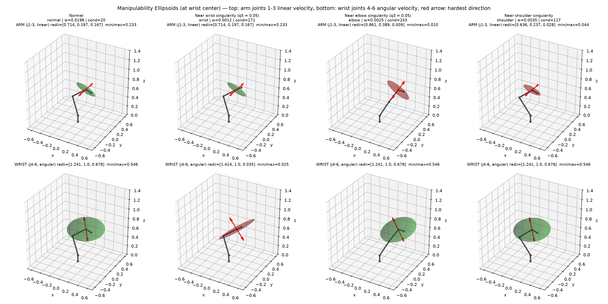
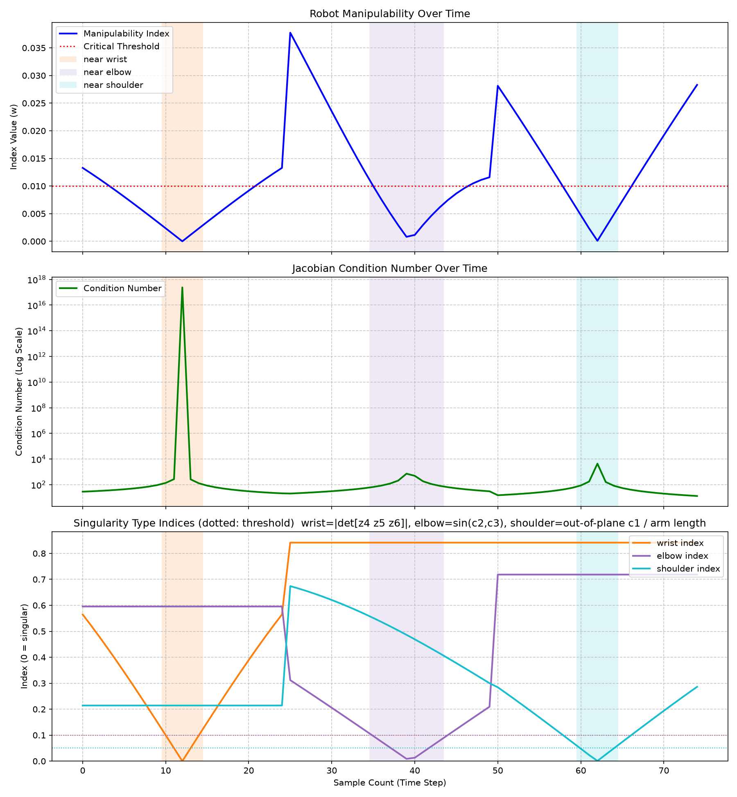
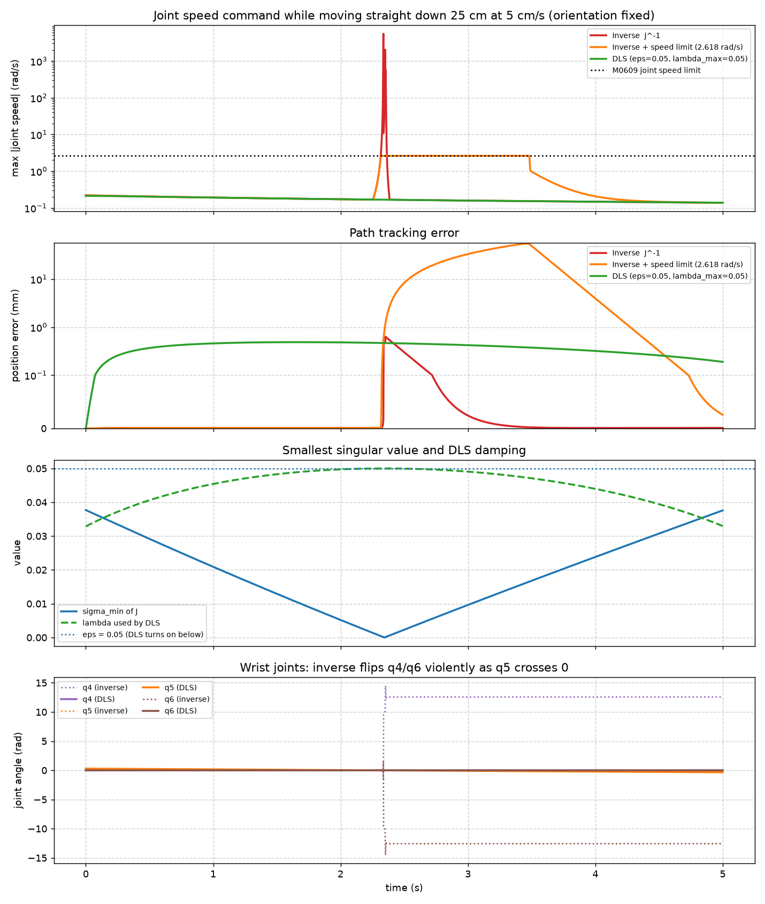

# 이론과 실험

[← README](../README.md)

특이점 분석에 쓰는 이론, 특이점 종류 분류의 유도, 대시보드 근접도 계산, 속도 폭주 실험을 정리했습니다.

- [왜 특이점이 문제인가](#왜-특이점이-문제인가)
- [Jacobian · Manipulability · Condition Number](#jacobian--manipulability--condition-number)
- [가동성 타원체](#가동성-타원체-manipulability-ellipsoid)
- [특이점 종류 분류](#특이점-종류-분류)
- [대시보드의 근접도·도달 예상 시간·벗어나는 방향](#대시보드의-근접도도달-예상-시간벗어나는-방향)
- [속도 명령 폭주와 감쇠 최소제곱 (DLS)](#속도-명령-폭주와-감쇠-최소제곱-dls)
- [말단 링크를 link_6 으로 지정하는 이유](#말단-링크를-link_6-으로-지정하는-이유)

## 왜 특이점이 문제인가

산업용 로봇은 특정 자세에서 자유도를 일부 잃는 특이점(Singularity)을 가집니다. 특이점 근처에서는

1. 특정 방향으로 움직일 수 없고
2. 제어 오차가 커지며
3. 관절 속도 명령이 폭주하고 ([DLS 실험](#속도-명령-폭주와-감쇠-최소제곱-dls))
4. 진동·불안정이 생깁니다.

이 프로젝트는 Jacobian 기반 기구학 분석으로 특이점을 실시간으로 찾고, 어떤 종류인지와 얼마나 가까운지를 보여 줍니다.

## Jacobian · Manipulability · Condition Number

### Jacobian
관절 속도 $\dot{q}$ 와 말단 속도 $\dot{x}$ (선속도 3 + 각속도 3) 의 관계입니다.

$$\dot{x} = J(q)\,\dot{q}$$

Robotics Toolbox 로 URDF 를 불러와(`URDF_read`) 현재 관절각 $q$ 에서 `jacob0(q, end='link_6')` 로 base 좌표계 기준 6×6 Geometric Jacobian 을 구합니다.

### Manipulability (Yoshikawa)
$$w = \sqrt{\det(JJ^T)}$$
클수록 좋은 자세이고, 0 에 가까울수록 특이점에 가깝습니다.

### Condition Number
$$\kappa(J) = \frac{\sigma_{max}}{\sigma_{min}}$$
1 에 가까울수록 이상적이고, 커질수록 특이점에 가깝습니다. 완전 특이점이면 무한대입니다.

| 상태 | Manipulability | Condition Number |
|---|---|---|
| Normal | 큼 | 낮음 |
| Near Singularity | 매우 작음 | 매우 큼 |
| Singularity | 0 근접 | 무한대 |

`visualize_results.py` 는 $w = 0.01$ 에 경고선을 그립니다. 예를 들어 M0609 에서 q5 를 0.8 → −0.8 rad 로 움직이면 $w$ 는 q5 = 0 에서 0 으로 떨어지고(V자), 조건수는 10¹⁷ 정도까지 치솟습니다.
다만 $w$ 와 조건수는 "특이점에 가깝다"만 알려 줄 뿐 **어느 관절 때문인지**는 알려 주지 않습니다. 그래서 아래 [특이점 종류 분류](#특이점-종류-분류)로 따로 판단하고, $w$ 가 0.01 아래로 떨어지지 않아도 지표 하나가 임계값 아래면 그 종류의 특이점 근처로 분류합니다.

## 가동성 타원체 (Manipulability Ellipsoid)

관절 속도를 크기 1 인 구 $\|\dot{q}\| \le 1$ 안에서 움직일 때 말단 속도 $\dot{x} = J\dot{q}$ 가 그리는 모양이 타원체입니다. 특이값 분해 $J = U \Sigma V^T$ 에서

- 축 방향 = $U$ 의 열벡터, 반지름 = 특이값 $\sigma_1 \ge \sigma_2 \ge \sigma_3$
- $w = \prod \sigma_i$ (타원체 부피에 비례), 조건수 = $\sigma_{max} / \sigma_{min}$ (얼마나 납작한지)
- 가장 짧은 축이 **가장 움직이기 어려운 방향**이고, 특이점에서는 그 반지름이 0 이 됩니다.

### 왜 타원체를 둘로 나누어 그리나
말단 전체의 선속도 타원체($J$ 의 위 3행)나 각속도 타원체(아래 3행)만 보면, 특이점에서도 다른 관절이 조금씩 메워 줘서 0 까지 줄지 않습니다.
예를 들어 손목 특이점($q_5 = 0.05$)에서 말단 각속도 타원체의 가장 짧은 반지름은 1.15 → 0.72 로 줄어드는 정도입니다. 그래서 [특이점 종류 분류](#특이점-종류-분류)와 같은 방식으로 나눕니다.

- **ARM 타원체**: 팔(1~3축)이 손목 중심을 움직이는 선속도, $J_{11}$ (3×3) → 팔꿈치·어깨 특이점에서 납작해짐
- **WRIST 타원체**: 손목(4~6축)이 손을 돌리는 각속도, $J_{22} = [z_4\ z_5\ z_6]$ (3×3) → 손목 특이점에서 납작해짐

| 자세 | 분류 | ARM 반지름 | WRIST 반지름 |
|---|---|---|---|
| 정상 (0, -0.3, 1.2, 0, 1.0, 0) | normal | 0.714, 0.197, 0.167 | 1.241, 1.000, 0.678 |
| 손목 근처 ($q_5$ = 0.05) | wrist | 0.714, 0.197, 0.167 | 1.414, 1.000, **0.035** |
| 팔꿈치 근처 ($q_3$ = 0.05) | elbow | 0.861, 0.389, **0.009** | 1.241, 1.000, 0.678 |
| 어깨 근처 ($q_2$ = -0.65, $q_3$ = 1.5) | shoulder | 0.636, 0.237, **0.028** | 1.241, 1.000, 0.678 |

특이점 종류마다 **해당 타원체 하나만** 납작해지고, 다른 하나는 정상 자세와 같습니다. 그림은 `ros2 run singularity_analysis plot_ellipsoid` 로 만듭니다.

## 특이점 종류 분류

M0609 는 4·5·6번 관절 축이 한 점(손목 중심, `link_5` 원점)에서 만나는 **구형 손목(spherical wrist)** 구조입니다.
손목 중심 $p_{wc}$ 를 기준점으로 Jacobian 을 쓰면 블록 삼각행렬이 되고, 기준점을 말단으로 옮겨도 행렬식은 같으므로

$$\det J = \det J_{11} \cdot \det J_{22}$$

- $J_{11} = [c_1\ c_2\ c_3]$, $c_i = z_i \times (p_{wc} - p_i)$ : 팔 3축이 손목 중심을 움직이는 선속도
- $J_{22} = [z_4\ z_5\ z_6]$ : 손목 3축의 회전축

또 $\det J_{11} = c_1 \cdot (c_2 \times c_3) = (c_1 \cdot n)\,\|c_2 \times c_3\|$ ($n$ = $c_2 \times c_3$ 방향 단위벡터) 이므로, 행렬식이 0 이 되는 경우는 세 가지입니다.

| 종류 | 대시보드 이름 | 조건 | 지표 (0이면 특이점) | 임계값 | 물리적 의미 |
|---|---|---|---|---|---|
| 손목 (wrist) | J4·J5·J6 | $\det[z_4\ z_5\ z_6] = 0$ | $\lvert\det[z_4\ z_5\ z_6]\rvert$ | 0.10 | 4·6번 축이 일직선 ($q_5 \approx 0$, 약 ±5.7° 이내) → 손을 돌리는 축 하나를 잃음 |
| 팔꿈치 (elbow) | J2·J3 | $c_2 \parallel c_3$ | $\sin\angle(c_2, c_3)$ | 0.10 | 팔이 완전히 펴지거나 접힘 → 팔 방향으로 더 못 늘어남 |
| 어깨 (shoulder) | J1 | $c_1 \cdot n = 0$ | $\lvert c_1 \cdot n \rvert$ / 팔 길이(0.779 m) | 0.05 | 손목 중심이 1번 축 쪽으로 옴 → 1번 관절이 새 방향을 못 만들어 옆으로 못 움직임 |

- 임계값은 M0609 URDF 로 각도를 바꿔 가며 정했습니다(`singularity.py` 의 `*_LIMIT`).
- 계산에는 `jacob0(q, end='link_6')`(말단)과 `jacob0(q, end='link_5')`(손목 중심) 두 Jacobian 만 있으면 됩니다. `link_5` 가 없는 URDF 에서는 종류 분류를 건너뛰고 경고를 띄웁니다.
- 수치 확인 결과 $\det J$ 와 $\det J_{11} \cdot \det J_{22}$ 는 $q_4 = 0$ 인 자세에서 완전히 같고, 일반 자세에서는 상대 오차 $10^{-4}$ 수준으로 같습니다. URDF 에 90° 회전이 `1.571`(π/2 의 근사)로 적혀 있어 손목 세 축이 약 0.03 mm 어긋나기 때문입니다(실제 로봇도 조립 오차가 있어 완벽한 구형 손목은 아닙니다).

아래는 손목 → 팔꿈치 → 어깨 특이점을 차례로 지나가는 동작을 `visualize_results` 로 그린 것입니다. 색칠된 구간마다 해당 지표 하나만 0 으로 떨어집니다.

## 대시보드의 근접도·도달 예상 시간·벗어나는 방향

### 근접도와 물리량
지표(0 이면 특이점)를 사람이 읽기 쉬운 값으로 바꿉니다(`singularity.py` 의 `physical_value`, `proximity`).

| 종류 | 물리량 | 임계값 (근접도 100%) | 경고 시작 (근접도 0%) |
|---|---|---|---|
| 손목 | 4·6번 축 사이 각 = asin(지표) | 5.7° | 17.5° |
| 팔꿈치 | c₂·c₃ 사이 각 = asin(지표) (팔이 펴짐/접힘까지 남은 각) | 5.7° | 17.5° |
| 어깨 | 손목 중심 ↔ 1번 축 거리 ≈ 지표 × 팔 길이 | 3.9 cm | 11.7 cm |

근접도 = (경고 시작 − 지표) / (경고 시작 − 임계값) 을 0~1 로 자른 값이고, 경고 시작 = 임계값 × `warn_factor`(3) 입니다. 100% 가 곧 특이점 분류의 경계라 CSV 의 `singularity_type` 과 일치합니다.

관절 위험도는 그 관절이 걸린 조건의 근접도입니다(`KIND_JOINTS`, `joint_risk`). 한 관절이 여러 조건에 걸리면 가장 큰 값을 씁니다.

### 도달 예상 시간과 벗어나는 방향
지표의 관절 기울기 $\nabla_q s = \partial s / \partial q$ 를 전진 차분으로 구합니다(Jacobian 12번, 대시보드에 발행할 때만).

- 지표 변화 속도 $\dot{s} = \nabla_q s \cdot \dot{q}$ 가 음수(줄어드는 중)이면 **도달 예상 시간** = (지표 − 임계값) / $(-\dot{s})$ (30초 이내만 표시)
- 기울기 성분이 가장 큰 관절과 그 부호 → **벗어나는 방향** (예: 손목 특이점이면 q5 를 지금 부호 쪽으로)
- $\dot{q}$ 는 `/joint_states` 의 `velocity`(두산 드라이버·ros2_control 은 채워 줌)를 쓰고, 비어 있으면(관절 슬라이더) 직전 메시지와의 차분을 평활해서 추정합니다.

## 속도 명령 폭주와 감쇠 최소제곱 (DLS)

"속도 명령 폭주"를 직접 보여 주는 시뮬레이션입니다(`ros2 run singularity_analysis velocity_demo`, ROS 없이 URDF 만 사용).

**상황**: 말단 자세(방향)는 고정하고 아래로 25 cm 를 5 cm/s 로 직선 이동합니다. 이 경로는 $q_5$ 를 0.3 rad 에서 0 을 지나 −0.3 rad 까지 끌고 가서 **손목 특이점을 통과**합니다.
매 순간 원하는 말단 속도 $\dot{x}$ (경로 속도 + 오차 보정)를 관절 속도로 바꾸는 방법 세 가지를 비교했습니다.

| 방법 | 식 | 최대 관절 속도 | 최대 경로 오차 |
|---|---|---|---|
| 역행렬 | $\dot{q} = J^{-1}\dot{x}$ | **5,558 rad/s** | 0.63 mm |
| 역행렬 + 관절 속도 제한 (2.618 rad/s) | 위 $\dot{q}$ 를 비율 축소 | 2.62 rad/s | **54.7 mm** |
| 감쇠 최소제곱 (DLS) | $\dot{q} = J^T (JJ^T + \lambda^2 I)^{-1} \dot{x}$ | **0.21 rad/s** | 0.49 mm |

- **역행렬**: 특이점에서 $J^{-1}$ 이 무한대로 커져, 아주 짧은 순간 4·6번 관절이 반대 방향으로 약 두 바퀴(±12.6 rad)씩 돕니다. 실제 로봇이라면 속도 한계(M0609 URDF 기준 2.618 rad/s)의 2,000배가 넘는 명령입니다.
- **역행렬 + 속도 제한**: 실제 제어기처럼 속도를 막으면 폭주는 없지만, 그 사이 경로를 못 따라가 5 cm 넘게 벗어납니다.
- **DLS**: 최소 특이값이 $\varepsilon$ 보다 작아질 때만 $\lambda^2 = \left(1 - (\sigma_{min}/\varepsilon)^2\right)\lambda_{max}^2$ 로 감쇠를 켭니다(Nakamura·Chiaverini 방식). 못 움직이는 방향의 속도를 조금 포기하는 대신 관절 속도를 작게 유지합니다.
- **감쇠의 대가**: $\varepsilon = 0.1$, $\lambda_{max} = 0.15$ 로 감쇠를 키우면(`--eps 0.1 --lam 0.15`) 관절 속도는 비슷하지만(0.20 rad/s) 경로 오차가 5.1 mm 로 커집니다. 안전(속도)과 정확도(오차) 사이의 균형을 $\lambda$ 로 고르는 것입니다.

## 말단 링크를 link_6 으로 지정하는 이유
M0609 URDF 에는 끝이 열린 링크가 두 개 있습니다. 높이 표시용 `base`(base_link 위 0.45 m)와 말단 `tool0` 입니다. Robotics Toolbox 는 말단을 지정하지 않으면 그중 **첫 번째**를 말단으로 고르는데, URDF 에서 `base` 가 먼저 나와서 엉뚱한 Jacobian 이 계산될 수 있습니다(터미널에 "More than one end-effector present" 경고가 뜹니다). 그래서 모든 스크립트가 `link_6` 을 명시합니다. `link_6` 은 `tool0` 과 원점이 같아 `jacob0` 결과가 같습니다.

그리퍼(RG2)를 달아도 특이점 판정(det J)은 기준점 위치와 무관해 그대로입니다. 단, 말단 선속도 타원체·가동성 값은 기준점에 따라 달라집니다.
